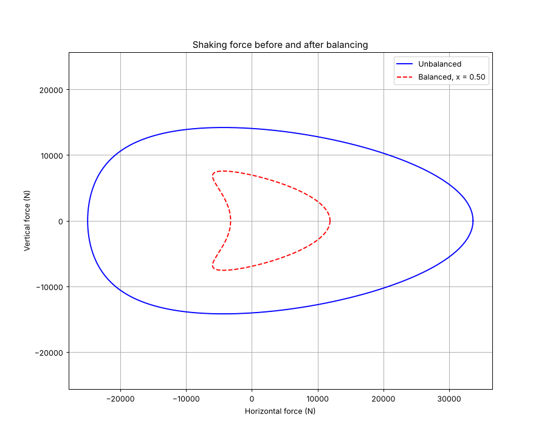

# Slider-Crank Dynamic Balancing

Dynamic balancing optimization of a slider-crank mechanism in Python. This was an optional bonus assignment in the Dynamics of Machinery course at Shiraz University, attempted by only a few students.

## The problem

A slider-crank (like a single-cylinder engine) shakes its frame because its moving parts keep accelerating. A counterweight on the crank can cancel the rotating part of this force completely, but not the back-and-forth part of the piston. It can only shift that part between the horizontal and vertical directions. The question: **what fraction x of the reciprocating mass should the counterweight balance?**

## How it works

- **Lumped masses:** the crank and connecting rod are replaced by a rotating mass at the crank pin and a reciprocating mass at the piston. SymPy solves the mass split so that the rod's total mass and center of mass are preserved.
- **Shaking force:** computed over one crank revolution as the rotating part plus the primary (cos θ) and secondary ((r/l)·cos 2θ) reciprocating parts. It is stored as a complex number: real part = horizontal, imaginary part = vertical.
- **Counterweight:** balances all of the rotating mass and a fraction x of the reciprocating mass.
- **Optimization:** searches x from 0 to 1 and picks the value with the smallest mean shaking force (trapezoidal integration over one revolution).

## Result

| | Unbalanced | Balanced (x = 0.50) |
|---|---|---|
| Mean shaking force | 22,528 N | 7,858 N (**−65%**) |
| Peak shaking force | 33,632 N | 11,888 N |

The optimum x = 0.50 matches the classic engineering rule of thumb of balancing one half to two thirds of the reciprocating mass.

## How to run

    pip install numpy sympy matplotlib
    python slider_crank_balancing.py

## Tools

Python, NumPy, SymPy, Matplotlib

## Update (Nov 2026)

Revisited this coursework and corrected it: the balancing model now uses a counterweight instead of scaling the reciprocating forces, the candidate selection now picks the best x instead of the worst, and the x search uses a finer grid (0.01 steps).
